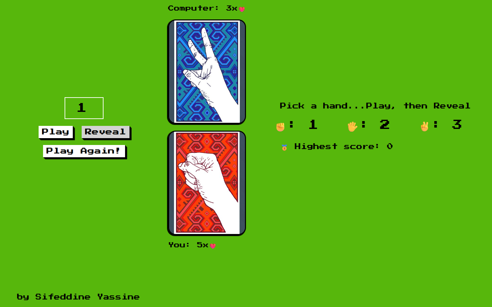

# Rock Paper Scissors

A browser-based Rock–Paper–Scissors game against the computer, built with vanilla JavaScript, HTML, and CSS.

Both you and the computer start with **5 lives**. Each round you pick a hand, play, then reveal both cards with a flip animation. Lose a round and you lose a life. Last one standing wins, and the lives you have left when you win are tracked as your high score.



## Features

- Play against a random computer opponent
- Card-flip animation when hands are revealed
- Lives system (5 ❤️ each) with live score updates
- High-score tracking across games in the same session
- **Play Again** to start a new round or reset after a game ends

## Tech Stack

- HTML5
- CSS3 (flip animation via CSS transforms)
- Vanilla JavaScript (no dependencies)

## Project Structure

```
rock-paper-scissors/
├── index.html    # Game layout
├── style.css     # Styles and card-flip animation
├── script.js     # Game logic (picks, scoring, high score, reset)
├── image1.jpg    # Rock card
├── image2.jpg    # Paper card
├── image3.jpg    # Scissors card
└── back.png      # Card back
```

## Getting Started

No installation needed.

```bash
git clone https://github.com/SifeYassine/rock-paper-scissors.git
cd rock-paper-scissors
```

Open `index.html` in your browser.

## How to Play

1. Enter your hand in the input field:

   | Number | Hand        |
   | :----: | ----------- |
   | 1      | ✊ Rock      |
   | 2      | 🖐️ Paper     |
   | 3      | ✌️ Scissors  |

2. Click **Play** to lock in your choice.
3. Click **Reveal** to flip the cards and update the lives.
4. Click **Play Again!** for the next round. If you knock the computer down to 0 lives, your remaining lives are recorded as the high score (when they beat the previous best). Once either side reaches 0, **Play Again!** starts a fresh game with 5 lives each.

## Author

**Sifeddine Yassine** · [@SifeYassine](https://github.com/SifeYassine)
